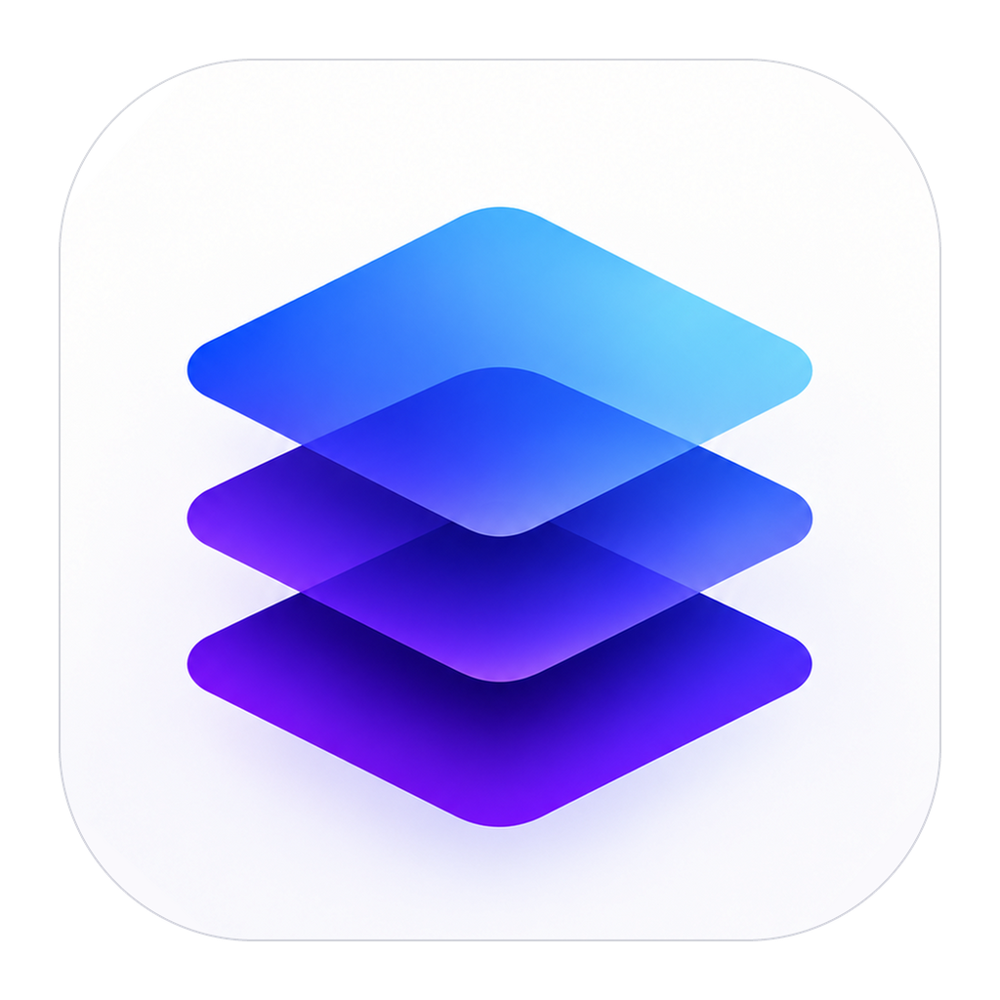
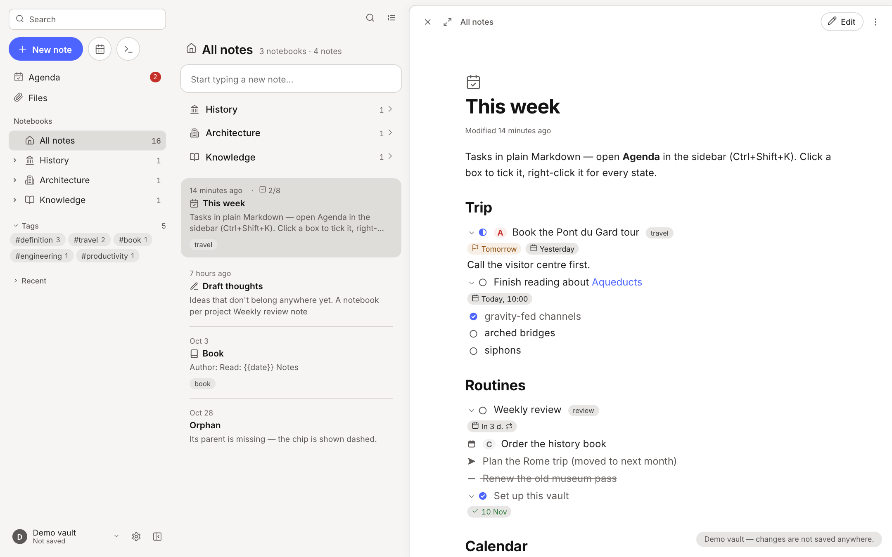
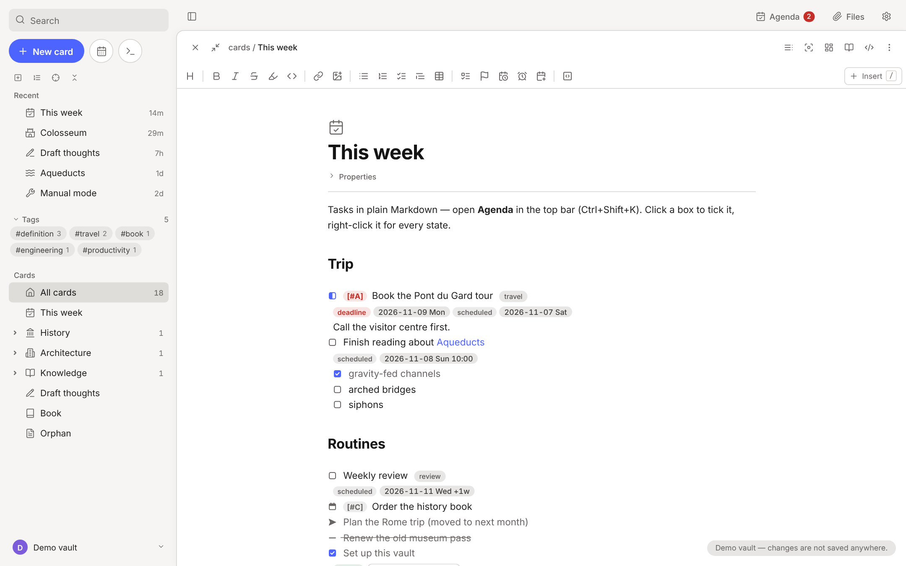
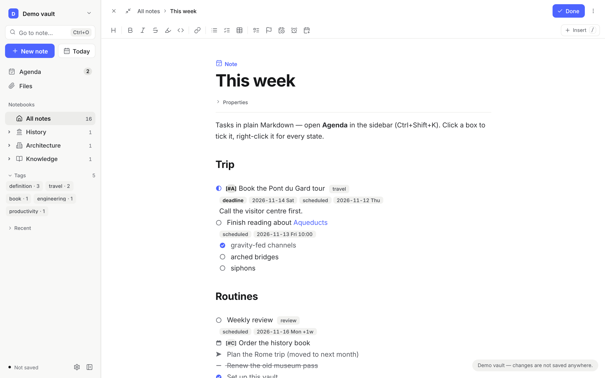
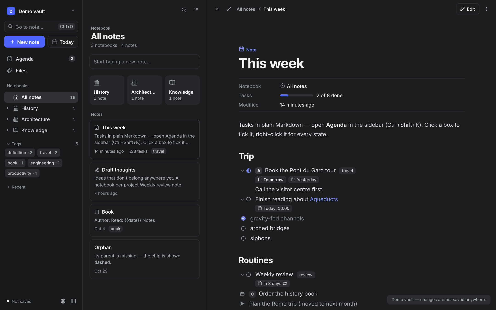
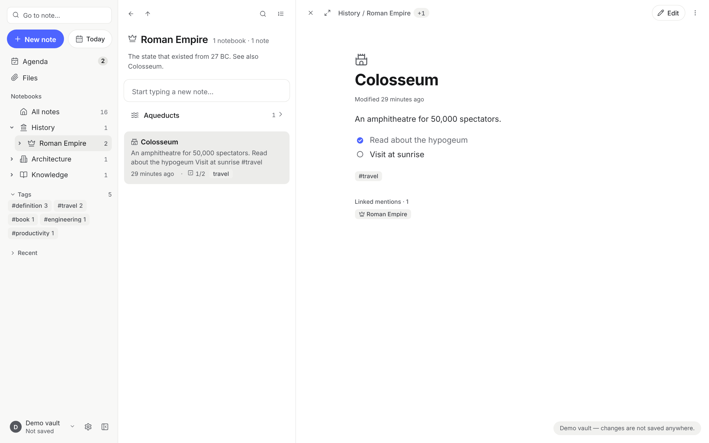
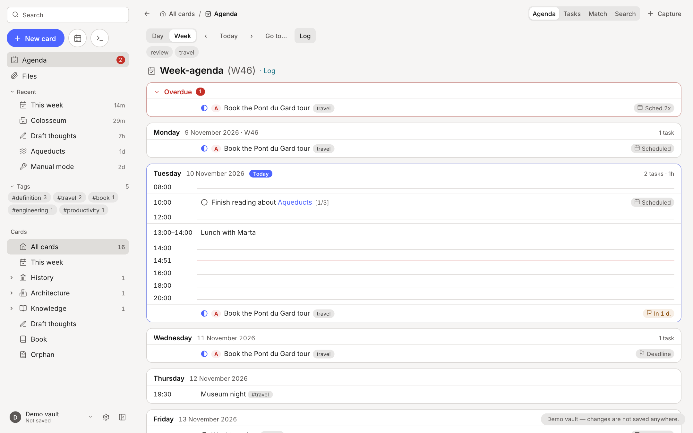
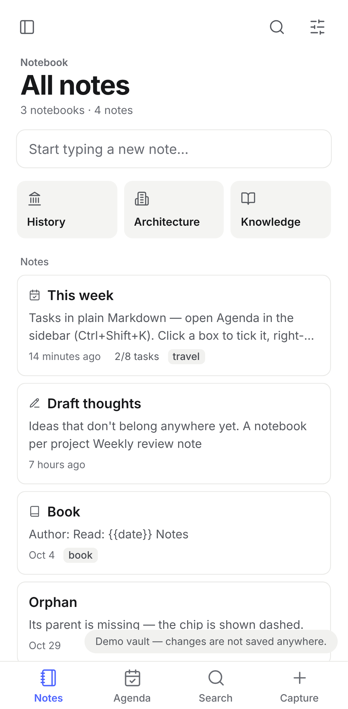
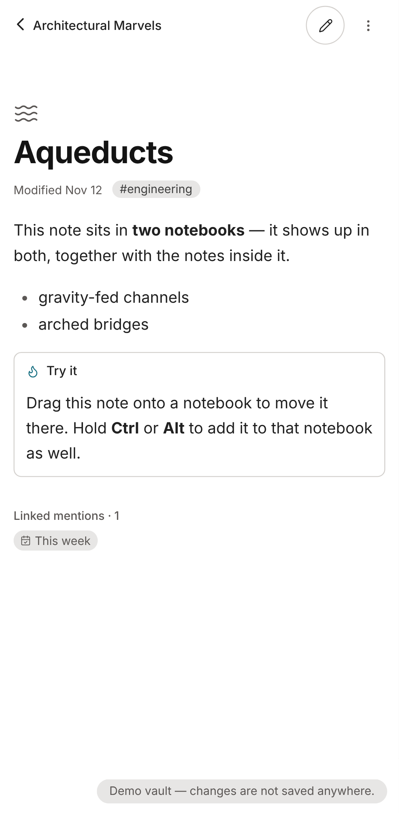

<div align="center">



# Supstack

**Your Markdown notes in notebooks — with tasks, an agenda and git sync.**

Supstack shows a folder of Markdown notes (a *vault*) as notebooks with a list of notes and the open note beside it, with tasks in six states, an agenda, and git sync between your devices. Every note is a plain `.md` file, so your notes stay yours.

[](https://github.com/RuslanGagushin/supstack/releases/latest)
[](https://github.com/RuslanGagushin/supstack/actions/workflows/apps.yml)
[](https://github.com/RuslanGagushin/supstack/actions/workflows/tests.yml)
[](LICENSE)
[](https://github.com/RuslanGagushin/supstack/releases)

[](https://github.com/RuslanGagushin/supstack/releases/latest)
[](https://github.com/RuslanGagushin/supstack/releases/latest)
[](https://github.com/RuslanGagushin/supstack/releases/latest)
[](https://v2.tauri.app)
[](https://www.rust-lang.org)
[](web/src/js)
[](https://codemirror.net)
[](CONTRIBUTING.md)

[**Download**](https://github.com/RuslanGagushin/supstack/releases/latest) · [Features](#what-it-does) · [Screenshots](#screenshots) · [Install](#install) · [Build from source](#build-on-your-computer) · [Contributing](#contributing)



</div>

## Why Supstack

- 🗂️ **Notebooks, not folders.** Notes nest in notebooks of any depth, and one note can sit in several notebooks at once.
- ✅ **Real task management in plain Markdown.** Six task states, priorities, `SCHEDULED` / `DEADLINE` dates with repeaters, and an agenda across the whole vault.
- ✍️ **Live preview editor.** CodeMirror 6 renders Markdown as you type: callouts, tables, code blocks, task boxes.
- 🔄 **Git sync built in.** Commit, merge and push from the app; conflicting edits are kept side by side, never lost.
- 📂 **Your files, untouched.** Supstack adds only the frontmatter it needs, so Obsidian, any editor, Git and Syncthing keep working on the same folder.
- 💻📱 **Native and small.** Windows, macOS and Android apps built with [Tauri 2](https://v2.tauri.app); the Windows installer is about 10 MB.

| Platform | Download | Vault access |
|---|---|---|
| Windows 10/11 | `.msi` or `-setup.exe` (about 10 MB, uses the built-in WebView2) | any folder, read and written in place |
| macOS 11+ | universal `.dmg` (Apple Silicon and Intel) | any folder, read and written in place |
| Android 7+ | `.apk` (64-bit ARM) | any folder you pick with the system picker, kept across restarts |

---

## Screenshots

<table>
  <tr>
    <td width="50%"><br><sub><b>Reading.</b> A note opens to read: its tasks show a priority letter and their dates as the agenda says them.</sub></td>
    <td width="50%"><br><sub><b>Editing.</b> <i>Edit</i> (or a double click) opens the live preview editor, with the Markdown as written.</sub></td>
  </tr>
  <tr>
    <td width="50%"><br><sub><b>Dark theme.</b> The same view, with light and dark themes following the system.</sub></td>
    <td width="50%"><br><sub><b>Inside a notebook.</b> Its own text as a description under the title, then the notebooks in it, then its notes.</sub></td>
  </tr>
  <tr>
    <td colspan="2"><br><sub><b>Agenda.</b> Tasks from the whole vault by day, with overdue items and a time grid.</sub></td>
  </tr>
</table>

<p align="center">
  
  &nbsp;&nbsp;
  
  <br><sub><b>On Android.</b> A single-column layout with a bottom bar; a note opens full screen with <i>‹ its notebook</i> to go back.</sub>
</p>

> Screenshots are taken from the built-in demo vault with `npm run screenshots`.

---

## What it does

### Notebooks and notes
- **A notebook is a note that holds other notes.** Nothing to set up: a note becomes a notebook as soon as another note lists it in its `parents` frontmatter property, and it can have its own text too. A note can sit in several notebooks at once, say *Personal* and *Documents*.
- **The sidebar lists the notebooks** first, nested, with how many notes each holds; **All notes** is the top level. The branch down to the notebook you are in stays open, and the notebook of a note opened from elsewhere is marked. Tags follow, and *Recent* (folded) comes last.
- **The list and the note side by side.** A notebook opens as a list: its title with how many notebooks and notes it holds, its own text as a short description (when it has some), then the notebooks inside it as compact rows, then its notes, each with when it changed, its title, two lines of text, tags and the first image. The first note opens beside the list, as a mail app does: the arrow keys page through the notes, → and ← go into a notebook and back out, the handle between them sizes the list, and ⤢ gives the note the whole width. On phones a tap opens the note over the list.
- **The note's header** shows the notebooks it sits in, each one a link to its list, with *+N* for its other places, then **Edit** (**Done** while editing) and **⋮**, which holds the outline, focus and source modes, *Move to…* and the rest of the note's actions. On phones it is just *‹ its notebook*, Edit and ⋮.
- Sorting (manual, by name, recently modified or newest first; notebooks stay on top) and **saved views**, so a list you like is one tap away.
- **Quick capture:** type into *Start typing a new note…* at the top of a list to create a note in that notebook. You can choose a **template note** for the notes of a notebook.
- **Select mode:** select several notes to move, add to another notebook or delete them together. **Undo** reverts the last change.

### Editor
- **Live preview editing:** the note is one editor (CodeMirror 6) that shows its Markdown rendered: headings, bold, italic, highlights, code, links, tags, task boxes, bullets and priorities read as they will look, and their Markdown shows only where the caret is. Callouts and code blocks render as blocks and open into their Markdown when you click or arrow into them; tables stay rendered and are edited a cell at a time. Click a link to follow it (Ctrl/Cmd+click opens the note in the editor), click a task's box to tick it (right-click it for every state), select text for a floating format bar (bold, italic, highlight, code, link, heading, lists, quote). Undo and redo cover every edit. Your files stay plain Markdown.
- **Foldable callouts and table editing:** `> [!info]+` makes a callout that starts open and `> [!info]-` one that starts folded; click its title to fold or unfold it. Click a table cell to edit it in place; Tab and Shift+Tab go to the next and previous cell, Enter goes to the cell below (Tab or Enter at the end adds a row, Enter on an empty last row leaves the table), Shift+Enter breaks a line in a cell, and Alt+arrows move the row or column. The table's Markdown keeps its columns lined up. Right-click a cell (or use the toolbar's table button) to add, move, delete, align or sort rows and columns; the + buttons under and beside a table add a row or a column.
- **Notes open to read.** The reading view puts one line under the title (when the note changed, its tags), shows a task's priority as a letter and its dates as the agenda says them (*Tomorrow*, *In 3 d.*, *12 Nov*; a deadline red when due, amber in its warning days). *Edit*, a double click or `Ctrl+E` switches to editing, where the dates are shown as written and *Properties* sits under the title; the note stays in place as you switch. **Settings › Appearance › Open notes** makes notes open for editing instead.
- A source mode for the whole file, **full-width** and **focus** modes, and a toolbar for formatting, images and files.
- `[[` or `Ctrl+L` links to another note; `/` opens the insert menu.
- **Embedded notes:** `![[Note]]` shows another note's text in place, and `![[Note#Heading]]` just that section, while reading and while editing; its name above it opens it. Embeds inside embeds go three levels deep, and one that would go round in a circle stays a link. Tasks in an embed are shown; tick them in their own note.
- Turn a selection into a **new note inside** the one you are in.

### Tasks and the agenda
- **A task is a list item with a box**, and the character in the box is its state. The editor, the reading view and the agenda draw each state as its own icon:

  | Box | State | |
  |---|---|---|
  | `- [ ]` | to do | open |
  | `- [/]` | in progress | open |
  | `- [<]` | waiting / scheduling | open |
  | `- [x]` | done | closed |
  | `- [-]` | cancelled | closed, left out of progress |
  | `- [>]` | forwarded (moved elsewhere) | closed, left out of progress |

  The set is fixed. Headings are never tasks. A click on the box ticks an open task or reopens a closed one; right-click it (or press `T` in the agenda) to pick any state; `Ctrl+Enter` steps `[ ]` → `[/]` → `[x]` and turns a plain line into a task.
- Tasks take **priorities** (`- [ ] [#A] …`), `:tags:` and **`SCHEDULED` / `DEADLINE`** dates on the line under them, with Org's repeaters (`+1w`, `++1m`, `.+3d`): closing a repeating task moves it to its next date. A dated task gets `CLOSED:` when it closes. Subtasks count towards their parent's `[2/5]`.
- The **agenda** (calendar icon, or `Ctrl+Shift+K`) collects them from the whole vault by day, a week or a month at a time (`d`, `w`, `M`; the month shows how many entries each day has, and a click opens the day), with a calendar to jump to a date and a quick-capture form for new entries. Its task list shows every open task or the ones in one state, and match queries filter by state (`STATE=doing`, `/wait|doing`).

### Search and filters
- `Ctrl+F` searches the notebook you are in, through every level, or the whole vault; filter by tag with `+tag` / `-tag` in the query, or with the Tags button. Notes with the words in their title come first, then those with them in a heading, then the rest. Results show which notebook each note sits in, with the line where the words are.
- `Ctrl+O` opens any note by name; `Ctrl+P` opens the command list.

### Sync
- **Git sync:** the vault folder is a git repository. **Sync now** (or the automatic sync, after edits and every few minutes) commits your changes, merges the remote branch and pushes. Set the remote URL (HTTPS) and a personal access token in **Settings › Git**; once sync is set up, the *Git* row in the sidebar shows its state and opens it.
- If a note changed on two devices, your text stays in place and the other version is saved next to it as `Note (conflict …).md`, so nothing is lost.
- The access token is never in the vault, so it is never committed or copied with the folder: on Windows and macOS it is kept in the system's keychain (Credential Manager, Keychain), on Android in the app's private storage. A `.gitignore` is created on the first sync for `.trash` and temporary files.
- On Android the repository lives in the app's private storage and is copied to and from the folder you picked on every sync, so the vault takes up space twice there.

### Look and keyboard
- No top bar: a full-height sidebar holds search, a blue *New note* button, the agenda, Files and Git sync, the notebooks, and the vault and settings at the bottom; it folds away and each view's own bar brings it back. Inter type, the open note on a white sheet on warm grey.
- Light and dark themes; English and Russian interface.
- Emacs-flavoured details: a minibuffer with key hints, and most actions have shortcuts. Org-style `C-c` chords work in the editor, for example `C-c C-t` to step a task's state and `C-c C-s` / `C-c C-d` to schedule or set a deadline.
- On phones the list fills the screen and a note opens over it with *‹ its notebook* to go back, the sidebar becomes a drawer, and the Android **Back** button closes the editor, menus and dialogs before leaving the app.
- **Settings** has a section per group: Appearance (language, theme, the list's default sort and size), Keyboard shortcuts, Git (in the app) and About, which shows the version and checks for updates.

### Updates
- The Windows and macOS apps check GitHub Releases when they start and twice a day. When a new version is out, a note appears in the minibuffer. **Settings → About → Install and restart** downloads it, checks its signature, installs it and restarts the app. Nothing is installed without asking, and the automatic check can be turned off there.
- Android can't update its own APK, so **Install** opens the new APK's download instead. Open the downloaded file to install it over the old one. This needs a signed APK; see [Android signing](#android-signing).

---

## Install

### From GitHub
Open the repository's **Releases** page (or the latest **Actions → Build apps** run, under **Artifacts**) and download the file for your platform.

- **Windows:** run the `-setup.exe` or the `.msi`.
- **macOS:** open the `.dmg` and drag Supstack to Applications. The app is not signed with an Apple Developer ID, so the first time, **right-click the app → Open**.
- **Android:** copy the `.apk` to the phone and open it, allowing installs from that app when Android asks. With USB debugging on, `adb install -r <file>.apk` works too.

### First start
1. Tap **Open vault folder** and choose your vault. On Android, go to the folder, tap **Use this folder**, then **Allow**.
2. After that, **Reopen** opens the same vault straight away.

Want to look around first? **Try the demo vault** loads sample notebooks in memory; nothing is saved.

---

## Where your data lives

| What | Where |
|---|---|
| Notes and notebooks | plain `.md` files in the vault's `cards/` folder |
| Daily notes | `daily notes/YYYY-MM-DD.md` |
| Pasted, dropped and uploaded files | `attachments/` |
| Which notebooks a note sits in | the `parents` frontmatter property in each note |
| Vault settings: pins, saved views, list options | `.supstack/settings.json` in the vault (versions up to 0.15 kept them under `.obsidian/plugins/`; they move on first open) |
| App settings, fold state, agenda view | stored per installation, not in the vault |
| Index cache: each note's text, frontmatter, tags and links, so reopening a vault reads only the notes that changed | stored per installation (IndexedDB), not in the vault; dropped and rebuilt when it doesn't match |

**The three folders are the same in every vault**, so there is nothing to set up: Supstack creates them as needed, and a folder that already exists with other letter case (`Cards/`) is used as it is. Each time a vault is opened, notes outside them are moved into `cards/`, keeping their subfolders, so links to them keep working; files that are not notes stay where they are.

**Changes made outside the app**, in another editor or by a sync tool such as Syncthing, are picked up as they happen on Windows and macOS: the app watches the vault folder and reads only the files that changed, and looks over the whole vault once a minute in case something was missed. On Android, and in a browser, the vault is looked over every few seconds while the app is in front, and whenever you switch back to it. Desktop writes go through a temporary file and a rename, so other apps never see a half-written note.

---

## How the app is put together

```
web/src/                    the Supstack page's sources: page.html, css/, js/ (ES modules) and vendor/ (libraries, fonts)
  js/core/                  pure logic: frontmatter, hierarchy graph, list model, tasks and dates, tables, texts
  js/services/              app state, the vault, saving and undo, attachments, Git sync, updates (no DOM)
  js/ui/                    everything on screen: list of notes, tree, editor, agenda, files, menus, settings
  js/main.js                the entry point: loads the layers in order and starts the page
scripts/page.mjs            builds them into one file, web/supstack.html (not committed)
scripts/web.mjs             builds the page and copies it to dist/index.html before every app build
src-tauri/                  the Tauri app: window, permissions (capabilities/default.json), icons
tauri-plugin-vault/         vault file access: pick the folder, list, read, write, delete, watch for changes (desktop)
  src/desktop.rs            Windows/macOS: plain file access with atomic writes
  android/…/VaultPlugin.kt  Android: Storage Access Framework, plus system-bar insets for the page
.github/workflows/apps.yml  builds all three apps on GitHub
scripts/android-signing.mjs creates an Android signing key and wires it into Gradle
icon.png                    source of every app icon (`npm run icons` regenerates them)
tests/                      page tests: the real page in headless Chrome on an in-memory vault, plus unit tests
                            of js/core/ in Node and a check of the layers (`npm test`)
```

The page is still a single HTML file, so it also works opened straight from disk. Its sources live in `web/src/`: `page.html` is the page with an `<!-- include: path -->` line where each stylesheet and library goes, and a `<!-- bundle: js/main.js -->` line where the app goes; `scripts/page.mjs` fills them in, bundling the app's ES modules with esbuild into one plain script. `npm test` and `npm run web` build the page first; `npm run page` builds just the page. `npm run codemirror` rebuilds `web/src/vendor/codemirror.js` after a CodeMirror update. Inside the app, the page switches its file access to the vault plugin and opens `http(s)://` and `mailto:` links in the system browser or mail app.

The app's modules come in three layers, and each uses only the ones before it (`tests/architecture.test.mjs` checks this):

- `core/` is pure logic. It doesn't touch the DOM, the browser's storage or the app's state; everything it needs comes in as arguments. That is why `tests/core.test.mjs` can run it in Node.
- `services/` holds the app state and everything that reads and writes the vault. It never draws anything. When something happens that the page should show (a message, notes changed on disk, the editor should save first), it emits an event from `services/events.js`, and the `ui/` modules subscribe to those events.
- `ui/` renders and handles input, calling into `services/` and `core/`.

Each module imports what it uses, so a new file is just a new module imported where it is needed. A module that only sets itself up also goes into the list in `main.js`. For the page tests, `js/expose.js` makes every export a global when the page sets `window.__SN_EXPOSE__` before it loads; `tests/harness.mjs` does that.

On Android the app draws edge to edge (behind the status bar and gesture bar). The vault plugin measures those bars and pads the page so nothing ends up underneath them.

---

## Build on GitHub (no tools needed on your computer)

1. Push the repository to GitHub.
2. Open **Actions → Build apps → Run workflow**. A run takes about 15–25 minutes, less on later runs thanks to the cache.
3. Download the results from the run's **Artifacts**: **Supstack-Windows**, **Supstack-macOS**, **Supstack-Android**.
4. To publish a release, push a tag: `git tag v0.1.0 && git push --tags`. The same files are attached to a GitHub Release.

### Desktop update signing
The installed Windows and macOS apps only accept updates signed with the key whose public half is in `src-tauri/tauri.conf.json` (`plugins.updater.pubkey`).

- Add the private key as the repository secret `TAURI_SIGNING_PRIVATE_KEY`, with the contents of `~/.tauri/supstack.key`. If the key has a password, also add `TAURI_SIGNING_PRIVATE_KEY_PASSWORD`. Tagged builds are then signed, and the release gets a `latest.json` (made by `scripts/updater-manifest.mjs`) that the apps read.
- Without the secret, the apps still build, but a release can't update them. **Check now** falls back to comparing versions with GitHub and opens the release page.
- Keep a backup of the private key. If it is lost, installed apps can't take signed updates any more, and everyone has to download one release by hand. To start over with a new key, run `npx tauri signer generate -w ~/.tauri/supstack.key`, then put the new `.pub` contents in `tauri.conf.json`.
- When releasing, bump the version in `package.json`, `src-tauri/tauri.conf.json` and `src-tauri/Cargo.toml`; the page takes its version from `package.json` when it is built. A test checks that they match.

### Android signing
The workflow always builds a **release** APK. Android only installs signed APKs, and an update must be signed with the same key as the installed app.

- **Without setup**, each run signs the APK with a new one-off key. It installs fine, but the next build can't update it: uninstall first. Your notes are safe, since they live in the vault folder.
- **To update in place**, add two repository secrets under **Settings → Secrets and variables → Actions**:
  - `ANDROID_KEYSTORE_BASE64`: the key file as base64. Create the key once locally with `npm run android:init` and then `node scripts/android-signing.mjs`. Encode it with `base64 -w0 src-tauri/gen/android/supstack.jks`, or on Windows with `[Convert]::ToBase64String([IO.File]::ReadAllBytes("src-tauri\gen\android\supstack.jks"))`.
  - `ANDROID_KEY_PASSWORD`: the password from `src-tauri/gen/android/keystore.properties`.

Switching from a build signed with a different key (for example an older debug build) needs one uninstall.

---

## Build on your computer

All platforms need **Rust** (<https://rustup.rs>) and **Node.js 20+** (<https://nodejs.org>). Then run `npm install` once in this folder.

| Command | What it does |
|---|---|
| `npm run dev` | runs the desktop app without installing it |
| `npm run build` | builds the installers for the current OS |
| `npm run android:init` | creates the Android project in `src-tauri/gen/android` (once) |
| `npm run android:dev` | runs the app on a phone connected by USB |
| `npm run android:build` | builds a release APK for 64-bit ARM |
| `npm run icons` | regenerates every icon from `icon.png` (then `git checkout src-tauri/icons/android/*/ic_launcher_foreground.png`: those are made by hand for the Android mask) |
| `npm test` | runs the page tests in `tests/` with headless Chrome (set `CHROME_PATH` to use another Chromium) |
| `npm run test:rust` | runs the vault plugin's Rust tests (file access, git sync, watching the folder) |
| `npm run lint` | runs ESLint over the page's code, the scripts and the tests |
| `npm run typecheck` | type-checks `web/src/js/core/` (TypeScript over the JavaScript, no DOM in its lib) |

### Windows
1. Install **Microsoft C++ Build Tools** (<https://visualstudio.microsoft.com/visual-cpp-build-tools/>) with **Desktop development with C++**. WebView2 is already part of Windows 10 and 11.
2. Run `npm run build`. The first build compiles the Rust crates and takes several minutes.
3. The installers are in `src-tauri\target\release\bundle\msi\` and `…\bundle\nsis\`.

### macOS
1. Install Apple's command-line tools: `xcode-select --install`.
2. Run `npm run build`. The app is in `src-tauri/target/release/bundle/macos/`, the disk image in `…/bundle/dmg/`.
3. For one build that runs on both Apple Silicon and Intel:
   ```sh
   rustup target add aarch64-apple-darwin x86_64-apple-darwin
   npm run tauri build -- --target universal-apple-darwin
   ```

### Android (on Windows or macOS)
1. Install **Android Studio** (<https://developer.android.com/studio>). Under **Settings → Languages & Frameworks → Android SDK**, install **Android 16 (API 36)**, plus **Build-Tools**, **NDK (Side by side)**, **Command-line Tools** and **Platform-Tools**.
2. Point the build at them.

   Windows (PowerShell, then open a new terminal):
   ```powershell
   [System.Environment]::SetEnvironmentVariable("JAVA_HOME", "C:\Program Files\Android\Android Studio\jbr", "User")
   [System.Environment]::SetEnvironmentVariable("ANDROID_HOME", "$env:LocalAppData\Android\Sdk", "User")
   $ndk = Get-ChildItem -Name "$env:LocalAppData\Android\Sdk\ndk" | Select-Object -Last 1
   [System.Environment]::SetEnvironmentVariable("NDK_HOME", "$env:LocalAppData\Android\Sdk\ndk\$ndk", "User")
   ```
   macOS (add to `~/.zshrc`):
   ```sh
   export JAVA_HOME="/Applications/Android Studio.app/Contents/jbr/Contents/Home"
   export ANDROID_HOME="$HOME/Library/Android/sdk"
   export NDK_HOME="$ANDROID_HOME/ndk/$(ls -1 $ANDROID_HOME/ndk | tail -1)"
   ```
3. Add the Android targets to Rust:
   ```sh
   rustup target add aarch64-linux-android armv7-linux-androideabi i686-linux-android x86_64-linux-android
   ```
4. Create the project and the signing key once:
   ```sh
   npm run android:init
   node scripts/android-signing.mjs
   ```
   The key and its password are saved in `src-tauri/gen/android/` (`supstack.jks` and `keystore.properties`, both git-ignored). **Back them up**: updates must be signed with the same key.
5. Run `npm run android:build`. The APK is at `src-tauri/gen/android/app/build/outputs/apk/universal/release/app-universal-release.apk`.

---

## Limits

- **iPhone and iPad** aren't supported yet. Tauri can build for iOS, but the vault plugin has no iOS side.
- The macOS app isn't notarized, hence the right-click → **Open** the first time.

---

## Contributing

Contributions are welcome: bug reports, ideas, translations and pull requests alike.

1. Fork the repository and create a branch from `main`.
2. Run `npm install`, then `npm run dev` to start the desktop app.
3. Make your change. Keep the [module layers](#how-the-app-is-put-together) intact (`core/` → `services/` → `ui/`).
4. Run `npm test` (and `npm run test:rust` if you touched the vault plugin) and make sure everything passes.
5. Open a pull request that describes what changed and why. Screenshots help for UI changes.

Found a bug or have an idea? [Open an issue](https://github.com/RuslanGagushin/supstack/issues/new). See [CONTRIBUTING.md](CONTRIBUTING.md) for details.

## Acknowledgements

Supstack stands on the shoulders of these open-source projects:

- [Tauri](https://tauri.app) — the native app shell
- [CodeMirror 6](https://codemirror.net) and [Lezer](https://lezer.codemirror.net) — the editor
- [marked](https://marked.js.org) and [DOMPurify](https://github.com/cure53/DOMPurify) — Markdown rendering and sanitizing
- [js-yaml](https://github.com/nodeca/js-yaml) — frontmatter
- [PDF.js](https://mozilla.github.io/pdf.js/) — PDF previews
- [Lucide](https://lucide.dev) — icons
- [Inter](https://rsms.me/inter/) — the typeface

The task model and agenda are inspired by [Org mode](https://orgmode.org).

## License

Supstack is released under the [MIT License](LICENSE). Bundled third-party libraries keep their own licenses.

<div align="center">

If Supstack is useful to you, consider giving it a ⭐ on GitHub.

</div>
