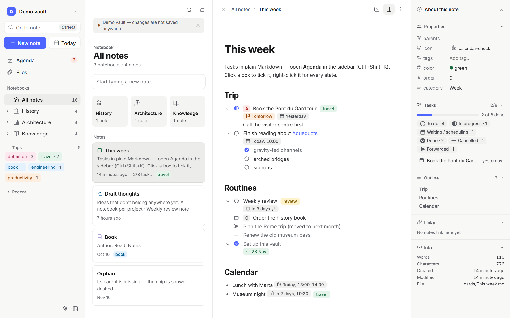
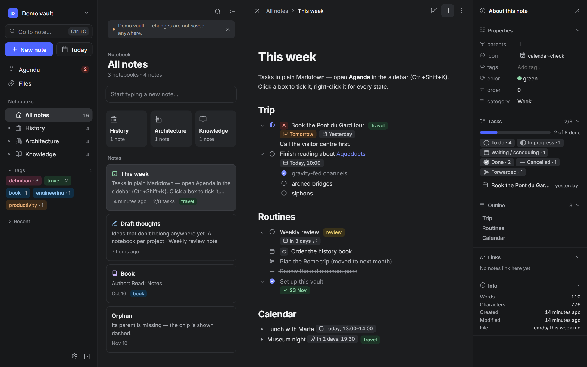
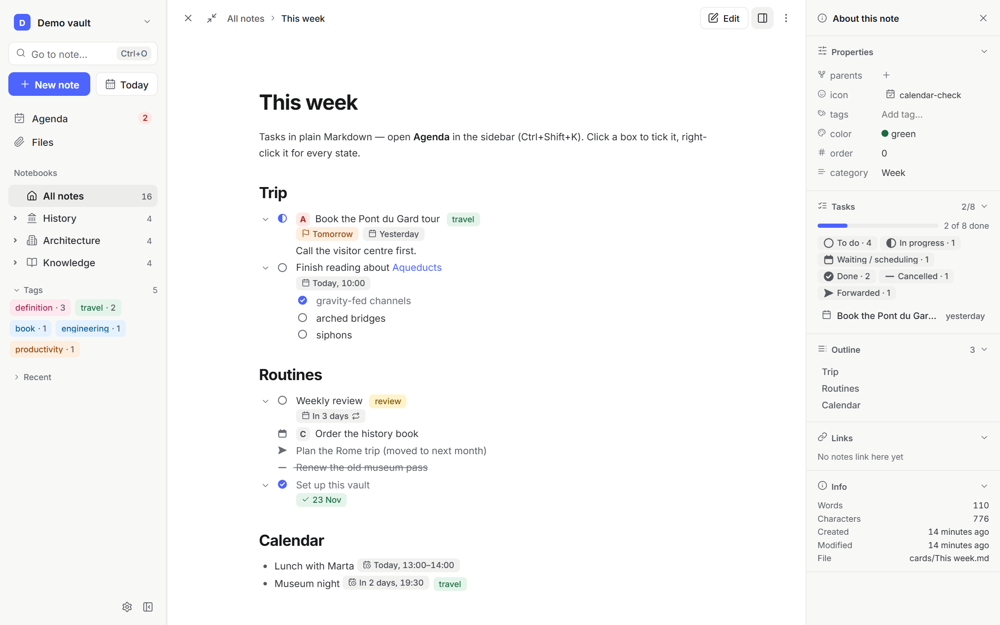
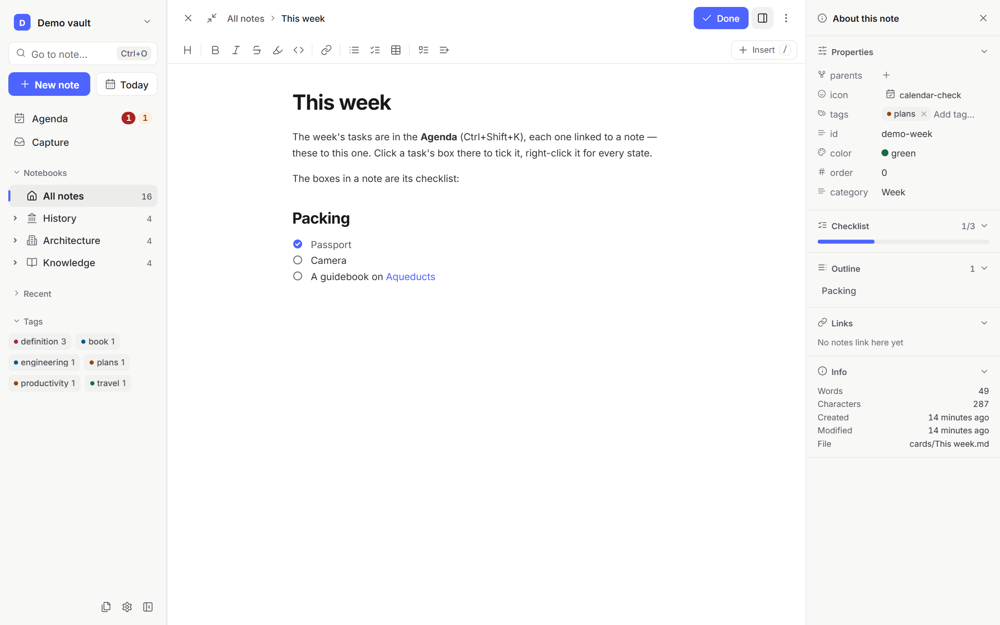
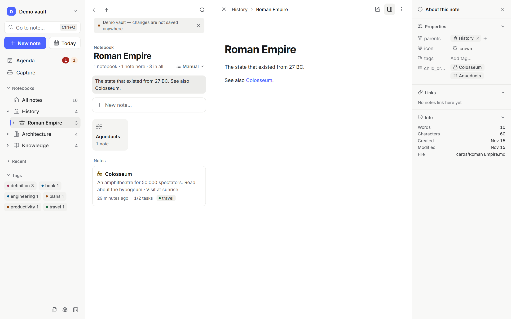
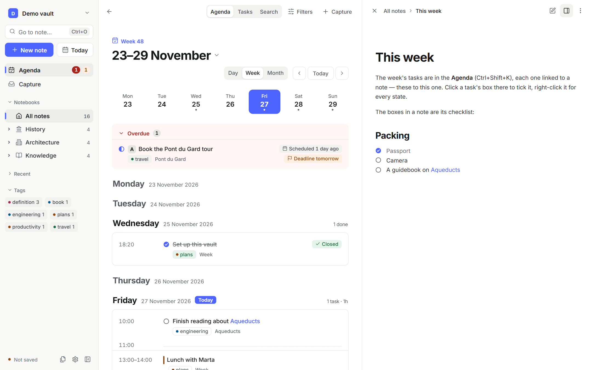

# Supstack design system

How the app's interface is put together: the variables every style draws from, the components built on them, and the rules the tests hold the styles to. The variables live in [`web/src/css/base.css`](../web/src/css/base.css); the components in the other six stylesheets, loaded in this order: `base`, `board`, `chrome`, `frame`, `writing`, `agenda`, `app`.

**The look** (since the 0.33 restyle): one white page in three columns, the sidebar on a light grey, hairlines between them and around cards rather than shadows; bold titles, with a small label in the accent only where the page needs to say what it is (the list, the agenda); rectangular plates rather than pills; the accent for the interface's own state; colour for content — each tag and note in its hue, deadlines orange, what is overdue red, what is closed green (0.34). Shadows are kept for what floats over the page: menus, popups, the toast, dialogs, the sidebar as a drawer, a raised segment. Red (`--todo`) is kept for what destroys, errors and an invalid field.

**The one rule:** a new value is a variable in `base.css` first. Colours, sizes, spacing, radii, shadows, layers, durations and weights are never written as numbers in a component's rule. `npm test` fails when one is (see [What the tests check](#what-the-tests-check)).

## Variables

### Colour

One palette, defined twice: on `body` for the light theme and on `body.theme-dark`. Components use these names only.

| Variable | Light | Dark | Use |
|---|---|---|---|
| `--bg` | `#f8f8f7` | `#17181a` | the sidebar, the open note's row, the overdue block, the welcome screen |
| `--win` | `#ffffff` | `#1c1d1f` | the page: the list, the note, the agenda; cards, menus, dialogs, fields |
| `--panel` | `#f1f1ef` | `#2a2c30` | plates: chips, segment tracks, hovered rows |
| `--hover-bg` | `#f4f4f2` | `#25272a` | a control under the pointer |
| `--sel` | `#ececea` | `#303236` | the selected row; a control being pressed; text selection |
| `--line` | `#e9e9e7` | `#2e3034` | borders and separators: between the columns, around cards |
| `--line-strong` | `#d9d9d6` | `#3b3d42` | the open note's card in the list |
| `--fg` | `#2a2c30` | `#dcdde0` | text |
| `--ink` | `#17181a` | `#f2f3f4` | text that has to stand out: titles, the active segment |
| `--muted` | `#55585e` | `#a9acb2` | secondary text; readable on every surface, plates included |
| `--faint` | `#686b72` | `#8e9198` | optional detail; 4.5:1 on `--bg` and `--win` **only**, never on `--panel`, `--sel` or `--hover-bg` |
| `--tag` | `#45484e` | `#c4c6cb` | text on a chip |
| `--accent` | `#4d64ff` | `#7c8eff` | links, focus, the chosen item, progress |
| `--accent-soft` | `#ebeeff` | `#1f2547` | an accent plate: an included filter, the selected agenda row |
| `--cta`, `--cta-hover` | `#4d64ff`, `#3245bb` | `#4d64ff`, `#3245bb` | the primary button and its hover (darker in both themes, so its white text keeps 4.5:1) |
| `--accent-ink` | `#3245bb` | `#7c8eff` | the accent as text on an `--accent-soft` plate: an included filter, a chosen quick date |
| `--danger-fill` | `#c42f27` | `#c42f27` | the fill of a button that destroys, under `--on-accent` text (`--todo` is too light for it in the dark theme) |
| `--panel-strong` | `#e4e4e1` | `#36383d` | the stronger plate: counts, priority A, an overdue date |
| `--todo` | `#c42f27` | `#ff7c70` | actions that destroy, errors, an invalid field |
| `--hue-green-bg`/`-fg` … `--hue-purple-bg`/`-fg` | six plates and their text | | a tag's hue (`.hue-*`, picked by its name: `util.js hueOf`), a note's icon and type label (`.ic-*`: its `color` field, else by its name; `vault.js cardHue`; notebooks stay grey), an event's bar; orange is also "soon" and today's count |
| `--due-bg`, `--due-fg`, `--due-soft` | `#fde8e6`, `#a8251e`, `#fef5f4` | `#3f1f1e`, `#ff9d94`, `#261b1b` | what is due or overdue: the overdue chip, block, head and count, priority A, the now line |
| `--l2`, `--l3`, `--l7`, `--l8` | | | syntax colours in code blocks; content, not interface |
| `--flash`, `--code-bg`, `--tbl-head`, `--tbl-head-line` | | | search highlight, code blocks, table heads |
| `--on-accent` | `#fff` | `#fff` | text and marks on an `--accent`, `--cta` or `--danger-fill` fill |
| `--img-edge` | `#0000001a` | `#ffffff1a` | the 1px edge inside a picture: pure black or white at 10%, never a tinted grey |
| `--paper` | `#fff` | `#fff` | the white of a page: a PDF, the switch's knob |
| `--shade` | `--fg` | `#000` | the colour of shadows and dims |

Three colours are worked out from the palette: `--accent-hover` (a primary control under the pointer), `--line-hover` (a border under the pointer) and `--scrim` (the dim behind a dialog).

### Type

| Variable | Value | Use |
|---|---|---|
| `--font-ui` | Inter | the interface and a note's text |
| `--font-code` | JetBrains Mono | code, keys, Markdown source |
| `--fs-sm` | 12px | the smallest text: dates, counts, chips, keys |
| `--fs-ui` | 13px | the interface's default |
| `--fs-md` | 14px | list titles, menu items |
| `--fs-note` | 14px | a note's text (as in Evernote: the note reads at the interface's size, its headings carry the structure) |
| `--fs-text` | 16px | the interface's larger text (the command palette's field, the phone's date strip) |
| `--fs-lg` | 20px | section titles |
| `--fs-xl` | 24px | the list's title, the welcome title |
| `--fs-title`, `--lh-title`, `--ls-title` | 30px (28px up to 820px wide), 1.15, −0.025em | a page's title: a note's, the agenda's days and month, a phone's list. Outside the six sizes, like a note's headings |
| `--ls-head` | −0.02em | the list's title and a note's headings |
| `--h1-size` … `--h6-size` | 24, 22, 17, then 14px | a note's own headings |
| `--fw-regular`, `--fw-medium`, `--fw-semibold`, `--fw-bold` | 400, 500, 600, 700 | weights |
| `--lh-tight`, `--lh-ui`, `--lh-text` | 1.25, 1.5, 1.65 | titles and headings; the interface; a note's text |

Six sizes and no more (spec UI-20); `tests/typography.test.mjs` measures them on the page.

### Spacing, corners, sizes

| Group | Variables | Rule |
|---|---|---|
| Spacing | `--sp-2`, `-4`, `-6`, `-8`, `-10`, `-12`, `-14`, `-16`, `-20`, `-24`, `-32`, `-40`, `-48` | named by their size in pixels; every `padding`, `margin` and `gap`. Negative: `calc(var(--sp-8) * -1)`. In a note's text, `em` follows the font size and stays |
| Corners | `--r-xs` 6, `--r-s` 8, `--r-m` 12, `--r-l` 16, `--r-pill` | xs: chips, tags, keys, inline code, a priority; s: fields, rows, small buttons, and the items of a menu or floating bar (4px inside an m corner: 8 + 4 = 12, so the corners are concentric); m: cards, tiles, menus, labelled buttons (`.sn-btn`, a dialog's buttons); l: dialogs; pill: only counts, the switch and the tasks bar. Circles are `50%` (since 0.46, after Capacities: m was 10) |
| Control heights | `--ctl-xs` 20, `--ctl-s` 24, `--ctl-m` 28, `--ctl-l` 32, `--ctl-field` 34, `--ctl-touch` 40 | xs: small chips; s: chips, icons in a row; m: fields, buttons in bars; l: sidebar buttons, menu rows; field: the search fields; touch: the least a finger gets (spec UI-9) |
| Icons | `--icon-xs` 12, `--icon-s` 14, `--icon-m` 16, `--icon-l` 18; `--icon-stroke` 1.75px | Lucide icons; one stroke |
| Tiles | `--tile-min` 96px (set per list, up to 200px) | the narrowest a notebook's tile gets; `fitTiles` widens it to the longest word in the names |
| Panels | `--insp-w` 280 | the note's panel beside the note |

### Depth, focus, motion, layers

| Group | Variables | Use |
|---|---|---|
| Shadows | `--shadow-1` | a raised segment, the switch's knob, the edge of a page or image. Every step is two or three layers, a tight one under wide faint ones (since 0.46, after Capacities), so a thing lifts without a visible smudge; whatever floats keeps its hairline for its edge. `--sh-k` scales them: 1 in the light theme, 2.5 in the dark |
| | `--shadow-2` | a card of the board under the pointer |
| | `--shadow-3` | menus, popups, the toast, bars that float |
| | `--shadow-4` | dialogs; the sidebar over the note |
| Focus | `--ring`, `--ring-inset` | a 2px accent ring outside a control, or inside the edge of a row or a pane. Buttons and links use `outline: 2px solid var(--accent)` |
| Motion | `--dur-1` 120ms, `--dur-2` 200ms, `--ease` | hover, folding, small changes; panels, bars, popups. With `prefers-reduced-motion` nothing slides, turns or spins: chevrons, the switch and the tab bar change at once, the toast and previews only fade, a spinner holds still and fades in and out (`--dur-pulse`), scrolls from script jump (`scrollBehavior()`); colour changes and the new note's flash stay |
| Layers | `--z-raised` 1, `--z-resizer` 3, `--z-float` 5, `--z-tabbar` 28, `--z-side` 30, `--z-editor` 35, `--z-welcome` 40, `--z-loading` 45, `--z-menu` 60, `--z-modal` 70, `--z-popup` 74, `--z-toast` 80 | from the page up; a neighbour one step above or below is `calc(var(--z-modal) + 1)` |
| Disabled | `--disabled` .4 | the opacity of anything that can't be used now |

## States

Every control has the same states, drawn the same way.

| State | Class or selector | Drawn as |
|---|---|---|
| Hover | `:hover`, always inside `@media (hover: hover)` | `--hover-bg` behind, text to `--fg`; never on a touch screen, where it would stick after a tap |
| Pressed | `:active` | `--sel` behind (a primary button: `--cta-hover`); the one rule is the last in `app.css` |
| Keyboard focus | `:focus-visible` | outline or `--ring`; panes that take keys show `--ring-inset` only once Tab has been pressed (`body.sn-kb`) |
| Selected | `.is-selected` | the current row, day or item: `--sel` or `--accent-soft` |
| Picked | `.is-picked` | the notes marked in multi-select |
| On | `.is-active` | a switch, a tab, a segment, a toggled button |
| Today, now | `.is-current`, `.is-today` | |
| Collapsed | `.is-collapsed` | |
| Warning | `.is-warn` | `--todo` text |
| Disabled | `[disabled]`, `:disabled`, `.is-disabled` | `--disabled` opacity, no pointer events |
| Invalid | `[aria-invalid="true"]` on a field | `--todo` edge and a soft `--todo` ring; screen readers say it too |

## Components

Markup is made with `h(tag, attrs, ...children)` and `iconBtn(icon, label, onClick, cls)` from [`web/src/js/ui/dom.js`](../web/src/js/ui/dom.js).

### Button — `.sn-btn`

A labelled button, usually with an icon.

| Variant | Class | Use |
|---|---|---|
| Default | `.sn-btn` | transparent, `--muted` text, `--ctl-l` high, `--r-m` corners |
| Primary | `.is-primary` | the one main action in a place: `--cta` fill, `--on-accent` text |
| Danger | `.is-danger` | an action that destroys something: `--todo` fill |
| Small | `.is-s` | inside a row of text |

```js
h("button", { cls: "sn-btn is-primary", type: "button", onClick: save }, ic("", "check"), t("save"))
```

Dialogs' buttons are plain `button` elements in `.modal-buttons`, with `.is-primary` or `.is-danger` on the main one. One primary button per dialog or bar.

### Icon button — `.clickable-icon`

An icon with no text; its name is in `aria-label` and `title`.

```js
iconBtn("trash-2", t("delete"), () => remove(path))
```

### Field

`input`, `textarea` and `select` get the base look from `base.css` at zero specificity (`:where`), so a field's own class always wins over it without `!important`. Height `--ctl-m`; focus `--ring`; invalid `aria-invalid="true"`; `select` is drawn by the app, with a chevron.

### Switch — `.checkbox-container`

`role="switch"`, `tabindex="0"`, `aria-checked`; Space and Enter flip it. On: `.is-active`, `--cta` track, `--paper` knob.

### Segmented control — `.sn-seg`

A `--panel` track of `.clickable-icon` segments, 28px (`.is-s`: 24px); the chosen one is a raised `--win` plate (`.is-active`, `--shadow-1`). A segmented control that switches views is `role="tablist"` with `role="tab"` and `aria-selected` on each segment.

```js
const seg = h("div", { cls: "sn-seg", role: "tablist" });
seg.append(h("button", { cls: "clickable-icon is-active", type: "button", role: "tab", "aria-selected": "true", text: "Week" }));
```

### Chip — `.sn-chip`

Tags, task dates, filters, notebooks. One plate: `--panel`, `--tag` text, `--fs-sm`, medium, `--r-xs`. No tone is a colour: the accent marks what is on, everything else differs in plate, weight and icon.

| | Class | Use |
|---|---|---|
| Size | (none) | 24px: chips that are controls (filters, the tag cloud) |
| | `.is-s` | 20px: chips in a row or a line of text (tags, dates, notebooks) |
| Tone | `.is-accent` | on, included: the accent plate, `--accent-ink` text; a chip that toggles also shows a check and has `aria-pressed` |
| | `.is-danger` | due, excluded: `--panel-strong`, ink, semibold |
| | `.is-warn` | soon: ink on the plain plate |
| | `.is-outline` | inherited (a task's tag from its heading or its note) |
| Hue | `.hue-*` | a tag: the grey plate with a 6px dot in the tag's hue before its name (`util.js hueOf`), the same in the list, the agenda, a note's text and the sidebar's tags; the plate and the text never take the hue |
| | `.is-struck` | excluded filter, with `.is-danger` |
| Kind | `.is-link` | a `span` chip that opens something (a tag in a list row) |
| | `.is-missing` | a parent not in the vault: dashed, not a link |

A chip that is a `button` or an `a` gets hover by itself. `#tags` in a note's text are `a.tag` (clicks find them by that) and share the chip's look, in the editing view too (`a.tag.cm-sn-tag`, a widget); only with the caret in it does a tag show its Markdown, `#travel` (`span.cm-sn-tag`, a mark drawn on its own).

```js
h("span", { cls: "sn-chip is-s is-link", text: tag, onClick: () => openTagView(tag) })
dateChip("dead", "Tomorrow", "soon")   // task-icons.js: a deadline chip, tone soon → .is-warn
```

A modifier repeats the base's `:is(.sn-chip, .markdown-rendered a.tag)`; the base has to outweigh the generic `button` rule, and a modifier written as `.sn-chip.is-x` would lose to it.

### List row and card — `.sn-card`

A note in the list is `.sn-card.sn-row` with `role="option"` in a `role="listbox"`; the open note is `aria-selected`, picked notes `.is-picked`. Its icon and title first (a note with no icon of its own gets a quiet `file-text`, so every title starts in one column), then the text, then one line with the date, "2/8 tasks" and the tags (spec UI-22). The text is `util.js previewText`: the note's words without headings and empty labels (`**Author:**`, `Read::`), so a template previews as nothing; with **Show previews** off in the order's menu (`board.compact`, kept with the list's order) no row has one. A note is a white card with a hairline (an inset shadow, so the row keeps its size); the open one sits on `--sel` with `--line-strong`.

A notebook in the list is a tile, `.sn-row.is-folder`: its icon, its name on up to two lines (broken between words, never inside one; a longer name ends in an ellipsis, the whole name is its tooltip) and how many notes it holds, on `--hover-bg`. The tiles share a grid with the notes (`.sn-rows`), three to a row in a list of 360px; a tile is never narrower than its longest word (`board.js fitTiles` sets `--tile-min`, 96–200px, measured again once the page's font has loaded; a tile's sides are 10px, so three fit a 360px list), so a long word gives fewer tiles to a row rather than a broken one; a faint `.sn-list-label` ("Notes", `aria-hidden`) heads the notes under them. ↑ and ↓ walk the list in order; → goes into a notebook and ← back out; Enter opens.

The list's head, `.sn-list-head`: a faint kind (`.sn-list-kind`: Vault at the top, Notebook, Tag or Search), the title at 24px bold, and under it `.sn-list-sub`: the count ("3 notebooks · 4 notes here · 16 in all") and at the line's end the list's order in words (`.sn-list-sort`, "Manual ▾"), whose menu sorts the list and turns the previews off or on. It is the one sort control, on a desktop and a phone alike; the top bar has none. The field under the head (`.sn-composer`) starts with a + and says "New note…", so it does not read as a search. A notebook with its own text shows that text beside its children's list (on a desktop) rather than opening the first child.

**Search bar** — `.sn-filterbar`: the field, the filter buttons and a close button on one line. It is a container: below 560px the field and the close button keep the first line and the filters wrap under them.

**Standing notice** — `.sn-standing`: a demo vault or a copy says so in a `--panel` strip above the list, in the layout (not floating), with an orange dot (`.sb-dot`) and a close button; `role="note"`. Closed, it stays closed for that vault. While it shows, the sidebar's foot doesn't say "Not saved" again.

**Empty list** — `.sn-empty`: one line saying why. An empty search adds `.sn-empty-acts`, bordered `--win` buttons for the way out: search everywhere (when it searched one notebook) and clear the tag filters (when tags are on).

### A page's head

A note opens with its title at `--fs-title` and nothing over it: whether it is a notebook or a daily note shows in the tree. The agenda's days and month still open with what they are, in the accent with an icon (`.ag-kind`: Agenda · Week 46). Nothing about the note sits under its title, reading or editing (`#editor-props` is not shown): its notebooks, tags, tasks done and when it changed are in the note's panel, whose Properties (`.sn-prop`) keep a column of keys.

### The note's panel — `.sn-insp`

Everything about the open note beside its text ([`ui/inspector.js`](../web/src/js/ui/inspector.js)), on `--bg` with a hairline at its left, `--insp-w` wide. Its sections (`.sn-insp-sec`, a head that folds it with `.is-collapsed`, kept per device in `UI.inspFold`): **Properties** (the editing view's `.sn-prop` rows, editable while reading too), **Checklist** (the note's boxes: done of all in its head, once, and a bar; only with boxes), **Outline** (the headings; only with headings), **Links** (the notes that link here and the unlinked mentions) and **Info** (words, characters, created, modified, the file). The note's pane is a row: `.sn-editor-col` (header, toolbar, text: the container the toolbar's queries measure) and the panel.

Where it goes: a column from a pane of 760px (`INSP_DOCK`, a container query on `editor-pane`), shown or hidden by the header's `.sn-insp-btn` (kept in `UI.inspector`); the mentions under the text give way to it. A narrower pane gets it over the text (`.insp-peek`, no shadow), a phone as a sheet from the bottom (`--r-l` corners, a grab handle, the `--scrim` behind), both only while asked for. On a phone the mentions under the text are left out too: the sheet has them all. Esc, the scrim, ✕ or pulling the sheet down close it.

### Tree — `.sn-outline`

The notebooks: `role="tree"` and `role="treeitem"` with `aria-level` and `aria-expanded`; one Tab stop, arrows move, Right and Left open and close, Enter opens a notebook's list. Rows `.tree-item-self`, children `.tree-item-children` with an indent guide.

### Menu — `.menu`

`role="menu"` of `.menu-item` (`role="menuitem"`): icon, title, an optional check. 4px padding and `--r-m` around `--r-s` items. `.is-warn` for an item that destroys, `.is-disabled` for one that can't be used now. `--shadow-3`, `--z-menu`.

### Dialog — `.modal`

Over `.modal-bg` (`--scrim`), `--r-l`, `--shadow-4`, `--z-modal`; Escape closes it. Title, text, then `.modal-buttons`. The command palette and the pickers are `.prompt`: an input over a list of `.suggestion-item`s, arrows to move, Enter to choose.

### Toast — `.sn-toast`

`role="status"`, `aria-live="polite"`: one line at the bottom (at the top on a phone), with an Undo or other action button and a close button. `.is-quiet` for passing news (saved, synced). `--shadow-3`, `--z-toast`.

### Format bar and table bar — `.sn-fmtbar`, `.sn-table-bar`

A floating bar over a selection: `--win`, a hairline, `--r-m` around `--r-s` buttons (concentric), `--shadow-3`. `.sn-fmtbar` sits over selected text at `--z-popup`; `.sn-table-bar` over a selection in a table, just under the menus (`calc(var(--z-menu) - 1)`), with `.is-warn` on Delete.

### Table selection — `.sn-table-host`

In live preview ([`ui/table-select.js`](../web/src/js/ui/table-select.js)): handles on the left border of the row and the top border of the column under the pointer (`.sn-table-handle`, `--win` with a hairline, the accent when chosen; a click selects, a drag moves), accent dots on the border between two rows or columns that insert one there (`.sn-table-ins`), a 2px accent drop line while dragging (`.sn-table-drop`), and the chosen cells tinted with 8% of the accent (`.is-cell-selected`; a header cell keeps its own shade under the tint). An empty cell holds a line's height. On a touch screen each handle's tap area keeps to its border, and the add-row and add-column bars grow only away from the table, so a tap meant for a cell edits the cell.

### Fold buttons in a note

A heading's or a checklist box's fold arrow hangs in the margin left of it, shown on hover (always when folded), so a box stands at the list's edge, where the editing view draws it. On a touch screen or a page up to 820px wide there is no margin: it stands at the line's right end, always shown. A box with lines or boxes under it folds; nested boxes stand under their parent's text.

### Reading and editing stand in one place

Switching a note between reading and editing moves nothing: every line stands within a pixel or two of where the other view draws it. The editing view draws a nested item's indentation as the reading view's (`.cm-sn-indent`: each list item it sits in adds a task's `--box-lead` or a bullet's 1.6em), a bullet or a number with its space as the list's 1.6em (`.cm-sn-marker`), a long item wrapping under its own text (`.cm-sn-li`), and a blank line between blocks as the reading view's gap there (`.cm-sn-gap`: a paragraph's 1em, under a heading .5em of its size; a heading's own line adds the rest of its 1.5em above). The reading view's list items have no margin of their own and a nested list none under it, as editing stacks them. The note's column holds about 80 characters of its text (`.sn-editor-page`, 40 × `--fs-note` wide).

### Properties — `.sn-prop`

A key in `--faint` with its icon, the value in `--fg`; a list or a map shows as YAML (`.sn-prop-other.is-yaml`, code font, `--muted`). A `color` value has a palette icon and shows its hue as a 10px dot (`.sn-prop-swatch.hue-*`).

### Calendar — `.org-cal`

A month of `.cal-day` buttons in a `role="grid"`: arrows move a day or a week, PageUp and PageDown a month. The chosen day `.is-selected`, today `.is-today`, quick dates `.cal-q` (`.is-active` when chosen).

### Callout

In a note's text: `> [!type]` draws a frame with the type's icon and title; the icon is `--muted` for every type.

## Screenshots

[`docs/screenshots/`](screenshots/) shows the system on the demo vault; `npm run screenshots` takes them again in headless Chrome ([`scripts/screenshots.mjs`](../scripts/screenshots.mjs)), and `npm run visual` compares six key screens with their references.

| | |
|---|---|
|  |  |
|  |  |
|  |  |

## What the tests check

`npm test` holds the styles to these rules (`tests/architecture.test.mjs` reads the stylesheets; the others measure the page):

| Rule | Test |
|---|---|
| every variable used is defined, and every variable defined is used | `architecture` |
| no colour functions outside `base.css`; no hex colours outside it either (alpha masks and the language badges in `markdown.js` aside) | `architecture` |
| pressing a button, an icon button or a row shows | `ui-list` |
| no numbers in `z-index`, `font-weight`, `transition`, `animation` (the spinners and the new card's flash aside) | `architecture` |
| corners are `--r-*`, `50%`, `0` or a 1–2px hairline | `architecture` |
| `padding`, `margin` and `gap` use the spacing scale; the few measured offsets are listed in the test with their reasons | `architecture` |
| one layer: no `body.sn-app`, and `!important` only on the hide utilities | `architecture` |
| retired class names stay retired | `architecture` |
| six font sizes, a page's title aside; a note's title 30px, headings 24, 22, 17px and text 14px | `typography` |
| every text against its background, both themes: 4.5:1, 3:1 for large text | `a11y` |
| every Tab stop shows the focus | `a11y` |
| a chip's tone is drawn, not only named | `ui-markdown` |
